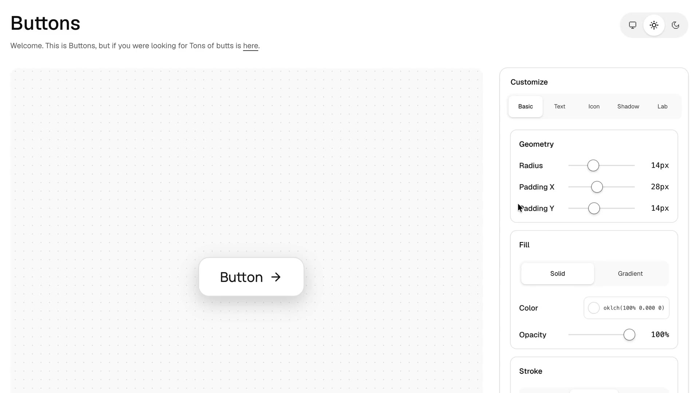

# Buttons

[buttons.tormo.at](https://buttons.tormo.at)

A button builder. Style one in the browser, copy CSS or Tailwind, or save SVG and PNG.

[](https://buttons.tormo.at)

## Run it

Node 22.12 or newer.

```bash
npm install
npm run dev
```

Open [http://localhost:3000](http://localhost:3000).

```bash
npm run typecheck
npm test
npm run build
```

No accounts, no database, no env vars. Icons come from [Iconify](https://iconify.design). If that request fails, the picker falls back to a small set.

## Reuse it

The Next.js app is just the wrapper. The builder lives in `components/button-builder/`.

- `button-builder-types.ts` is the config object
- `button-output.ts` turns that config into CSS, Tailwind, HTML, React, SVG, PNG, and a prompt
- `button-color-utils.ts`, `button-presets.ts`, `button-fonts.ts`, and `button-icons.ts` are the supporting pieces
- `button-builder.tsx` is the UI

You can copy those files into another project and keep the UI, or skip the UI and just call the generators.

```ts
import { DEFAULT_CONFIG } from "./button-builder-types";
import { getCssCode, getTailwindClasses, createSvgMarkup } from "./button-output";

const config = {
  ...DEFAULT_CONFIG,
  label: "Get started",
  fill: "#171717",
  textColor: "#ffffff",
};

getCssCode(config);
getTailwindClasses(config);
await createSvgMarkup(config);
```

PRs are welcome. If you change how a button exports, add a test in `tests/`.

## License

[MIT](LICENSE). Use it however you want.
